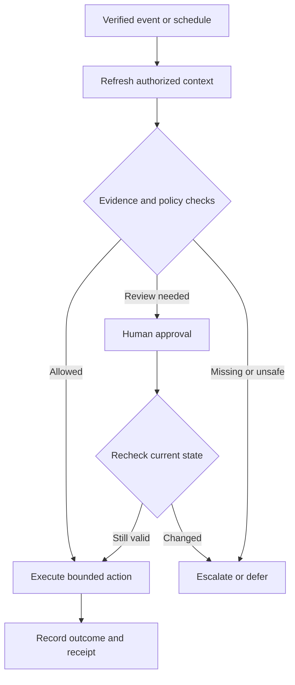

# Rental AI — Product Requirements Document

**Version:** 0.1 · **Research date:** 27 October 2026 (Asia/Bangkok)  
**Product sponsor:** Emanuel Wijnants / Libralytics  
**Status:** Research-backed proposal for product review; implementation has not started.  
**Reference:** [Guesty AI agents](https://www.guesty.com/lp/ai-agents-lp/#features)

## 1. Product decision

[Likely] Build Rental AI as an AI operations layer for rental-property teams: connect reservation and property data, answer routine guest questions, turn requests into accountable tasks, and show managers what needs attention.

[Likely] The smallest credible first release integrates with one existing property-management system (PMS). Replacing its booking distribution, payment processing, and accounting would make this a substantially different and larger project.

[Guessing] The proposed launch segment is Phuket operators managing 10–100 villas or apartments, with an English-speaking guest-service team and Thai-speaking operational staff. This is a working assumption based on the sponsor's business context, not validated customer research.

**Meaning of “clone” in this PRD:** reproduce useful product outcomes and interaction patterns through original software, naming, branding, and interface design. Guesty's private code, proprietary training data, marketing assets, customer testimonials, and claimed business results are not inputs we possess.

### Evidence conventions

- **[Certain]:** directly supported by the cited public source; confirms what the vendor documents, not independent product performance.
- **[Likely]:** interpretation or recommended product decision.
- **[Guessing]:** planning hypothesis requiring validation.
- **Requirement / target:** proposed Rental AI behavior, not a claim about an existing implementation.
- Sources use IDs such as [S1]; the complete linked bibliography is in section 19.

## 2. Research findings and implications

### 2.1 What Guesty documents

| Area | Evidence from public research | Rental AI implication |
| --- | --- | --- |
| Product breadth | [Certain] The reference page markets agents across guest service, operations, revenue, distribution, finance, accounting, and owner relations. [S1] | Plan a common agent framework; prioritize a small operational set. |
| Agent management | [Certain] Help documentation describes a catalog, activation, run history, results, approval expiry, scheduled runs, and manual execution. [S2] | A working agent console needs state, evidence, and action controls. |
| Automated replies | [Certain] AutoReply supports property scope, operating times, topic restrictions, sentiment/length filters, and a configurable AI confidence threshold with manual review below it. [S3] | Offer granular controls; do not treat model confidence as verified correctness. |
| Knowledge | [Certain] A pilot knowledge base supports property topics and uploaded/text sources. Structured property fields take precedence over conflicting source content. [S4] | Add published knowledge, explicit precedence, and conflict visibility. |
| Operational workflows | [Certain] Guesty describes message-derived tasks, commitment tracking, turnover checks, and shift summaries. [S5] | Close the loop from conversation to task completion. |
| Commercial packaging | [Certain] Guesty AI combines agents, AutoReply, and pricing tools on a per-listing basis; accounting agents additionally require Accounting. The reviewed article does not state an exact price. [S6] | Validate total integration and subscription costs before pricing Rental AI. |
| Permissions | [Certain] A dedicated article permits non-admin access through a custom role, while the general hub article says admin-only. [S2, S7] | Record documentation inconsistency; use explicit role/capability checks in our design. |

[Certain] The landing page advertises Lite from USD 9/month, but this is not evidence that the full AI agent package is available at that price. Its scale and training-data statements are vendor claims; the research did not independently verify their methodology. [S1, S6]

### 2.2 Integration feasibility

[Certain] Guesty's public API documentation exposes listings, reservations, conversations, message sending, and event subscriptions. Access requires an enabled account and appropriate permissions. Public documentation alone does not confirm commercial permission for a competing integration or access on a particular customer's plan. [S8, S11, S12]

[Certain] The documented API ceilings are 15 requests/second, 120/minute, and 5,000/hour, shared across account tokens. The authentication guide limits token creation to five per 24 hours per client ID. [S9, S10]

[Certain] Guesty documents signed webhooks, retries, duplicate and out-of-order delivery, and possible delivery delays from milliseconds to 30 minutes. [S13]

[Likely] Consequently, a usable connector needs cached reads, account-wide throttling, event deduplication, reconciliation, and explicit freshness indicators. It cannot promise instantly accurate availability merely because webhooks exist.

### 2.3 Competitor cross-check

| Product | Verified public behavior | Interpretation |
| --- | --- | --- |
| Hostaway | [Certain] AI drafts use conversation, listing, and reservation context; individual rules can send automatically. [S14] | [Likely] Generic AI replies are already a baseline capability. |
| Hospitable + Trellis | [Certain] Hospitable documents an external operations layer with two-way messages, task workflows, action logs, and Copilot/Autopilot modes while Hospitable remains the record system. [S15] | [Likely] An overlay is feasible as a product category, but is not unique by itself. |
| Rental AI proposal | [Guessing] English/Thai operational handoffs, property-specific knowledge quality, and measurable task resolution will appeal to Phuket teams. | Validate local advantage through pilots; do not claim an uncontested market. |

### 2.4 Research limits

- [Certain] Research used public vendor pages and official API/help documentation. No authenticated Guesty account, private API, live integration, or production workflow was tested.
- [Certain] A Meta documentation fetch was rate-limited; current WhatsApp onboarding, commercial terms, and messaging-policy details were not verified during this research.
- [Likely] Public documentation can establish candidate capabilities, but entitlement, channel coverage, delivery semantics, and partner terms require an integration spike.
- [Guessing] Willingness to pay, available pilot data, team size, implementation budget, and demand for mid-stay versus short-stay workflows remain unvalidated.

## 3. Problem, users, and value proposition

### Problem hypothesis

[Guessing] Small property teams lose time switching among guest messages, reservation records, cleaning schedules, and staff chats. Requests become informal promises with no clear owner; managers discover issues close to arrival.

**Proposed value proposition:** “Every guest request has an answer, an owner, and a visible outcome.”

### Primary users

| Persona | Job to be done | Required outcome |
| --- | --- | --- |
| Property manager | See operational risk and delegate work | One prioritized queue with evidence and ownership |
| Guest-service agent | Answer accurately across languages | Grounded drafts, clear context, fast human takeover |
| Operations coordinator | Turn guest needs into work | Structured tasks with due times and escalation |
| Cleaner / technician | Complete assigned work | Mobile task view with minimum necessary property information |
| Business administrator | Control automation and access | Scoped permissions, costs, activity, and stop controls |
| Property owner | Understand service and performance | Later-phase reporting limited to owned properties |

**Initial guest languages:** English and Thai. Other languages may generate review-only drafts until evaluated.  
**Initial operator interface:** English; Thai task labels and task translations for staff. Full interface localization is P1.  
**Initial time/currency defaults:** Asia/Bangkok and THB; preserve each property's time zone and each reservation's original currency.

## 4. Scope and release boundaries

### P0: production pilot

1. Multi-tenant accounts, property-scoped roles, and an operator dashboard.
2. One verified PMS connector with properties, reservations, and guest conversations.
3. A unified inbox for that connector, with grounded AI drafts and manual send.
4. Controlled automatic replies for an evaluated allowlist of routine questions.
5. Property knowledge with draft/published versions, visibility rules, and sources.
6. Message-to-task creation and a mobile task board.
7. Arrival-readiness checks and turnover-conflict detection.
8. Guest commitment tracking.
9. Shift handoff summaries.
10. Agent configuration, approvals, audit history, usage measurement, and kill switches.

P0 includes six agent types: Guest Reply, Request Dispatcher, Arrival Readiness, Turnover Conflict, Commitment Tracker, and Shift Brief. The inbox, knowledge base, and agent console are supporting product modules.

**P0 connector decision:** Guesty is the first technical candidate because its API is documented. Production selection remains conditional on pilot-customer fit, access rights, commercial permission, and successful read/write tests. If Guesty access is unsuitable, select one alternative using the same acceptance gates; do not implement several connectors simultaneously.

### P1: expansion after pilot gates

- LINE Official Account and WhatsApp Business connectors, each separately approved and tested.
- Review-to-task and review-response drafts.
- Task synchronization with the chosen PMS where supported.
- Availability-gap insights and manager-approved extension/upsell suggestions.
- Read-only portfolio analytics assistant with governed metric definitions.
- Full Thai operator interface; additional evaluated guest languages.
- Owner-facing operational summaries and a second PMS connector.
- Longer-stay service schedules and extension request handling.

### P2: separate discovery and investment

- Calendar writeback and maintenance blocks.
- Dynamic pricing and channel publication.
- Direct booking, payments, deposits, refunds, and owner accounting.
- Financial exception agents and bank reconciliation.
- Voice calls, smart locks, autonomous access-code delivery, native mobile apps.

**Not part of P0:** OTA certification, a channel manager, new reservations, booking cancellations, price changes, payment execution, account credential collection through chat, autonomous financial decisions, or a reproduction of Guesty's entire platform.

CSV/sample-data import is permitted for demonstrations and knowledge preparation. It does not qualify as a live PMS integration and cannot enable automatic guest messaging or claim current availability.

## 5. Core user journeys

### Journey A: activate a property

1. Administrator connects the approved PMS using the provider's supported authorization method.
2. System imports selected properties and future/current reservations; administrator resolves mapping errors.
3. Administrator reviews structured facts and publishes property knowledge.
4. Manager assigns operational staff and escalation coverage.
5. Manager enables agents in Observe mode, then Assist after reviewing evidence.
6. Automatic replies become available only after the property and language meet release gates.

**Success:** the property shows connection health, data timestamp, knowledge completeness, assigned manager, and permitted automation modes.

### Journey B: guest asks about Wi-Fi

1. A verified inbound event maps to one tenant, conversation, property, and reservation.
2. Reply agent retrieves the authorized, published Wi-Fi facts.
3. Policy checks determine whether the guest is eligible to receive the information.
4. In Assist mode, staff see the draft and its source; in Autopilot, an eligible draft enters a short cancelable queue.
5. Before sending, the system rechecks thread activity, reservation state, permissions, and automation settings.
6. The thread records provider acceptance and any supported delivery status.

**Failure behavior:** ambiguous identity, conflicting facts, unsupported language, or stale required data routes to a human. The model does not invent a password or use another property's instructions.

### Journey C: air-conditioning complaint

1. The system recognizes a maintenance request and suggests a property-linked task.
2. An approved routine rule creates one internal task; otherwise a coordinator approves it.
3. Staff receive location, issue, due time, and permitted access instructions.
4. The guest receives only a supported acknowledgement; the AI does not promise a technician arrival time without assignment evidence.
5. Staff record completion; the manager can reopen the task if the guest reports the problem persists.

**Success:** the task, conversation, assignment, and resolution evidence remain linked.

### Journey D: same-day turnover risk

1. A scheduled check compares departure, next arrival, and required cleaning duration.
2. Missing task coverage or insufficient time creates an actionable exception.
3. The manager assigns coverage or handles the booking through the PMS.
4. Rental AI refreshes the evidence and records the resolution.

**Boundary:** P0 never cancels a guest reservation or changes availability to resolve the conflict.

### Journey E: late checkout request

1. AI classifies the request as approval-required.
2. It shows available reservation/turnover evidence with freshness and unknown fields.
3. A manager decides in the PMS and refreshes Rental AI.
4. Staff approve a guest response based on the confirmed decision.

**Boundary:** apparent free calendar space is insufficient to promise an extension or charge a fee.

## 6. Functional requirements and acceptance criteria

All rows below are proposed requirements. P0 must pass its corresponding tests before production pilot.

| ID | Priority | Requirement | Acceptance criterion |
| --- | --- | --- | --- |
| FR-01 | P0 | Tenant and property isolation | A user, worker, retrieval query, export, and file URL cannot access another tenant or unassigned property; negative tests pass. |
| FR-02 | P0 | Connector onboarding | Import is resumable, paginated, mapped to stable external IDs, and shows partial failures; reconnecting produces no duplicate properties. |
| FR-03 | P0 | Conversation inbox | Show original messages, reservation context, assignments, translations, and send state; preserve chronological history and source IDs. |
| FR-04 | P0 | Property knowledge | Upload text/PDF or enter facts; show processing errors; only approved published content is usable for guest replies. |
| FR-05 | P0 | Grounded drafts | Every factual draft exposes supporting property/reservation fields or source passages to staff; missing support causes review. |
| FR-06 | P0 | Human takeover | Staff can pause a thread or property; pending automatic sends are canceled, and no new send proceeds until explicitly resumed. |
| FR-07 | P0 | Controlled auto-send | Enabled only for allowed property, language, category, hours, data state, and evaluated quality; a final policy check occurs immediately before send. |
| FR-08 | P0 | Agent console | Users can inspect purpose, trigger, scope, mode, last run, outcomes, failures, and evidence; inactive agents produce no new actions. |
| FR-09 | P0 | Internal task workflow | Create, assign, acknowledge, start, complete, and reopen tasks with reservation links; duplicate inbound events create one task. |
| FR-10 | P0 | Readiness report | Report each configured check as pass, fail, or unknown; missing integration data never counts as pass. |
| FR-11 | P0 | Turnover risk | Compare property-local stay boundaries and configured cleaning buffer; detect overlap without modifying the PMS. |
| FR-12 | P0 | Commitments | Extract proposed promises with message evidence; staff can confirm/reject; only completion evidence marks a promise fulfilled. |
| FR-13 | P0 | Shift brief | Summarize arrivals, departures, open commitments, urgent tasks, and unresolved messages for the property-local next 24 hours; link every item. |
| FR-14 | P0 | Approval queue | Show exact proposed action and evidence; support approve, edit, reject, expiry; edits or material data changes invalidate earlier approval. |
| FR-15 | P0 | Escalation | Route incidents to configured on-call staff, record acknowledgement, and escalate overdue incidents; unavailable coverage disables relevant autopilot. |
| FR-16 | P0 | Audit and usage | Record actor, model/config versions, evidence IDs, approval, execution result, provider IDs, and cost by tenant without exposing secrets. |
| FR-17 | P0 | Freshness and health | Display last successful sync and degraded state; required stale data blocks autonomous action; recovery triggers reconciliation. |
| FR-18 | P0 | Scheduling | Respect property IANA time zone, daylight-saving changes, quiet hours, and schedule revisions; execute one logical run per schedule window. |
| FR-19 | P0 | Language handling | Keep original text visible; preserve names, dates, amounts, and identifiers; uncertain/mixed-language intent routes to staff. |
| FR-20 | P0 | Export and retention | Authorized admins can export tenant records and initiate deletion; content is removed from retrieval, indexes, and future evaluations according to policy. |
| FR-21 | P1 | Additional channels | Each connector proves identity mapping, authorization, inbound capture, compliant outbound send, and duplicate prevention before activation. |
| FR-22 | P1 | Opportunity workspace | Recommendations include supporting dates, constraints, and freshness; manager approval precedes every commercial offer. |

## 7. Agent behavior and autonomy

### Modes

- **Off:** no new agent runs.
- **Observe:** evaluate and log; no guest messages or operational task mutations.
- **Assist:** propose a reply/action for human review.
- **Autopilot:** execute only actions explicitly allowed by tenant policy, property scope, and evaluation gates.

A change to a more permissive mode requires an administrator or delegated manager. A less permissive mode takes effect immediately. Staff may always pause automation within their permitted property scope.

| Agent | Trigger | Evidence | P0 output | Maximum P0 autonomy |
| --- | --- | --- | --- | --- |
| Guest Reply | New inbound guest text | Thread, reservation, published property facts | Draft or eligible reply | Auto-send routine allowlisted answers |
| Request Dispatcher | Guest request | Message and verified property mapping | Internal operational task | Create routine task under configured rule |
| Arrival Readiness | Hourly and on demand | Upcoming arrivals, knowledge, tasks, available status fields | Pass/fail/unknown checklist | Internal alert only |
| Turnover Conflict | Reservation/task change and scheduled scan | Stay dates, task duration, cleaning buffer | Conflict exception | Internal alert only |
| Commitment Tracker | Staff/AI outbound message and task change | Promise text, assignee, due time, completion record | Suggested commitment and overdue flag | Flag; never invent fulfillment |
| Shift Brief | Configured shift boundary and on demand | Current reservations, tasks, incidents, messages | Linked internal summary | Publish inside workspace |

**Always require human handling in P0:** refunds, payment disputes, booking changes, early/late arrival promises, compensation, access-code requests, threats, emergencies, discrimination complaints, and ambiguous guest identity.

**Safety-critical handling:** create an urgent incident and notify configured staff immediately. Any guest-facing emergency acknowledgement uses a manager-approved template. The AI must not claim emergency services were contacted or an issue was resolved without execution evidence.

### Grounding and evidence precedence

1. Authorization and disclosure rules override all content sources.
2. Current confirmed reservation-specific structured exceptions.
3. Current structured property facts.
4. Published property-specific policies and knowledge.
5. Published organization-wide guidance.
6. Conversation history supplies context and requests, not authority to alter policy.

Conflict resolution must consider validity dates and provenance. A guest saying “the manager promised a refund” creates a verification task; it does not become a confirmed refund policy.

Internal-only knowledge must never enter guest-generation context. Model-reported confidence is advisory; autonomous eligibility depends on evaluated category/language performance, source coverage, and deterministic policy checks.

## 8. Interface and information architecture

Use original Rental AI branding and an operational, data-dense interface. Primary navigation:

| Screen | Essential contents | Primary action |
| --- | --- | --- |
| Today | Arrivals, departures, urgent incidents, overdue tasks, connector health | Resolve highest-priority exception |
| Inbox | Threads, original/translated text, reservation panel, sources, draft, takeover | Review/send or assign |
| Tasks | Board/list, assignee, due time, priority, evidence, completion | Assign or complete |
| Properties | Structured facts, knowledge coverage, local time zone, manager | Correct missing knowledge |
| Agents | Catalog, modes, triggers, property scope, recent outcomes | Configure or inspect |
| Approvals | Proposed action, affected record, expiry, before/after when relevant | Approve/edit/reject |
| Activity | Filterable runs, execution receipts, incidents | Investigate |
| Settings | Team, roles, connections, escalation, retention, usage | Maintain account controls |

**UX requirements:**

- Operational state is understandable without reading a chat transcript.
- Distinguish “AI suggested,” “staff approved,” “provider accepted,” and “delivery confirmed.”
- Never show a green “ready” state when required data is unknown.
- Every alert offers an owner, next step, and source record.
- Responsive layouts support a 360px-wide staff task view.
- Text and icons accompany colors; keyboard navigation and readable contrast are acceptance requirements.
- Connection setup explains exactly what is imported and which actions can occur.
- Demo mode has a persistent label and cannot dispatch real messages.

A marketing website is optional P1 collateral. The product dashboard and verified workflows take precedence in this PRD.

## 9. Integration contracts and production gates

### Required connector capability matrix

| Capability | P0 requirement | If unavailable |
| --- | --- | --- |
| Property/reservation reads | Required, stable IDs and timestamps | Connector cannot qualify |
| Guest conversation reads | Required, original channel/thread association | Connector cannot qualify |
| Message send | Required for assisted production inbox; separately gated for auto-send | Demo/read-only mode only |
| Reservation/message events | Required or demonstrably adequate supported synchronization | No “live” claim; fail pilot if freshness targets cannot be met |
| Task reads | Optional | Use internal tasks; PMS task-dependent checks show unknown |
| Task writes | P1 | Internal task board is authoritative |
| Payment/readiness status | Optional, metadata only | Payment check shows unknown; no payment execution |
| Calendar writes | Not permitted in P0 | Open PMS for manager action |

### Guesty candidate implementation rules

- Use official current API documentation; verify supported authentication and scopes against the customer account. [S8]
- Cache tokens and serialize refreshes across workers. [S10]
- Budget requests across the entire account, honor rate-limit headers and Retry-After, and reserve capacity for interactive work. [S9]
- Use official conversation read/send interfaces; test actual channel routing rather than assuming every channel supports identical operations. [S11, S12]
- Validate event signatures, persist before acknowledging, deduplicate, and refresh authoritative records before decisions. [S13]
- Do not claim OTA delivery based solely on an HTTP success response.
- Record commercial/partner approval and data-processing terms before connecting customer production data.

### Freshness policy

These are proposed operating defaults, subject to connector testing:

- Required reservation/thread context for autonomous replies must have been successfully refreshed within five minutes; also re-fetch the latest thread before dispatch where supported.
- If refreshing would exceed provider limits, queue or route to staff; never silently lower the freshness requirement.
- Internal scheduled reports may use data up to 15 minutes old, clearly timestamped; older or incomplete required records show unknown/degraded.
- Availability, price changes, and access-code release remain outside P0 autonomous scope regardless of cache age.
- Show separately: provider event time, time received by Rental AI, and last successful record refresh. A recent local refresh is not proof that the provider itself has received every OTA update.

### Later channel requirements

[Certain] LINE's official documentation requires webhook-signature handling, describes duplicate/out-of-order events, and states that received text cannot later be re-fetched through a text retrieval API. [S16]

For a LINE connector, persist verified inbound text reliably, deduplicate by event ID, implement unsend handling, and require a verified reservation-to-contact mapping. Integration must use a business-controlled Official Account; do not assume personal chat access.

For WhatsApp, verify the current official authorization flow, business/number eligibility, templates, service-window rules, consent/opt-out behavior, delivery receipts, and charges during P1 discovery. These remain unverified dependencies, not committed capabilities.

## 10. System design requirements

[Likely] A modular application with a background worker is sufficient for the pilot. A separate microservice for each agent would add operational complexity before scale is established.

**Proposed components:**

- Web application and authenticated application API.
- Relational database with tenant and property authorization enforcement.
- Private document storage and a tenant/property-filtered retrieval index.
- Connector adapters for external reads, events, and approved writes.
- Durable queue, scheduler, retry/dead-letter handling, and transactional outbox.
- Workflow engine with bounded tools and a policy evaluator.
- Model gateway with schema validation, cost tracking, timeouts, and versioned prompts.
- Audit/event store, monitoring, and operational alerting.

**Proposed implementation direction:** TypeScript application/API, PostgreSQL, durable job processing, and a managed language-model endpoint chosen after English/Thai evaluations. Hosting, framework, model provider, and queue product are implementation decisions, not approved commitments.

### Execution integrity

- Guest text, uploaded documents, and external API content are untrusted data; none can grant tool permissions.
- Model output must conform to an allowed action schema. Server-side policy authorizes the exact action and target.
- Idempotency keys combine tenant, external event, action type, target, and relevant version.
- Serialize sends per conversation and recheck for new guest messages or staff takeover.
- Suppress self-generated outbound events to prevent agent reply loops.
- Use bounded retries and deadlines. A timeout after a provider may have accepted a send becomes outcome-unknown, requiring reconciliation rather than blind retry.
- Never imply globally exactly-once delivery where a provider cannot guarantee it.
- Side effects record provider identifiers and results; retries reuse the same logical action record.
- A tenant/property kill switch is checked again immediately before every external side effect.

### Run states

`queued → evaluating → proposed → awaiting_approval → executing → succeeded`

Alternative outcomes: `no_action`, `deferred`, `rejected`, `expired`, `superseded`, `failed`, `outcome_unknown`, `canceled`.

Observe-mode runs end in proposed/no-action without entering execution. Autopilot may skip human approval only after the same policy checks. A request accepted by a provider can succeed as an API action while delivery status remains pending; display both.

## 11. Data model

All operational records require tenant ID; property-scoped objects also require property ID or an explicit verified association.

| Entity | Key information and constraints |
| --- | --- |
| Tenant | Name, locale, billing currency, retention policy, automation state |
| User / Membership | Identity, role, allowed properties; unique membership per tenant |
| Property | PMS external ID, title, IANA time zone, structured facts, manager, active state |
| Reservation | External ID, guest reference, property, local stay dates, timestamps, status, currency; preserve source |
| Guest / ChannelIdentity | Provider identifiers and verified reservation links; no fuzzy automatic merging |
| Conversation / Message | Provider thread/message IDs, direction, original text, language, delivery state, version |
| KnowledgeSource / Version | Property scope, visibility, effective dates, publisher, content hash, extraction state |
| Task | Issue, property/reservation, assignee, due time, status, evidence, external reference if any |
| Commitment | Source message, promise, owner, due time, linked task, confirmed/fulfilled state |
| AgentDefinition / Configuration | Type/version, scope, mode, trigger, allowed actions, escalation, policy version |
| AgentRun | Trigger, context versions, result, model/version, timing, cost, error |
| ProposedAction / Approval | Exact payload hash, actor, decision, expiry, evidence/version snapshot |
| ActionExecution | Idempotency key, target, attempt count, provider receipt, outcome |
| Integration / SyncCursor | Encrypted credential reference, capabilities, account mapping, health, cursor |
| Incident / AuditEvent | Severity, ownership, acknowledgement, changes, immutable event metadata |
| UsageEvent | Tenant, run, units, cost currency, provider cost, channel cost, billable state |

**Record ownership:** PMS owns reservations and calendars; Rental AI owns agent configurations, published knowledge, internal tasks, approvals, and audit records. P1 task sync requires an explicit ownership/conflict policy.

Use decimal money or integer minor units with currency; never floating-point arithmetic for monetary amounts. Store instants in UTC and retain property-local dates for stay boundaries. Do not aggregate different currencies without an explicit conversion method.

### Proposed application API surface

These are Rental AI contracts to design, not claims about provider endpoints:

- `GET /properties`, `GET /reservations`, `GET /conversations`
- `POST /conversations/{id}/drafts`
- `POST /conversations/{id}/messages` with authorization, state version, and idempotency key
- `POST /conversations/{id}/takeover`
- `GET/POST /tasks`, `PATCH /tasks/{id}`
- `POST /knowledge/{id}/publish`
- `GET /agents`, `PATCH /agents/{id}/configuration`, `POST /agents/{id}/runs`
- `GET /approvals`, `POST /approvals/{id}/decision`
- `GET /activity`, `GET /integrations/{id}/health`
- `POST /webhooks/{provider}/{connectionId}` with provider authentication

## 12. Access, privacy, and operational control

### Permission model

| Role | Access | Restrictions |
| --- | --- | --- |
| Administrator | Connections, users, retention, automation policies, all assigned business data | Destructive settings require explicit review and an audit event |
| Manager | Assigned properties, approvals, staff assignment, agent mode changes if delegated | No unrelated properties or platform secrets |
| Guest services | Assigned conversations, draft/send, thread takeover, task proposals | No financial actions or access-policy changes |
| Cleaner / technician | Assigned tasks and necessary access/location information | No guest inbox, financial records, or unrelated tasks |
| Auditor | Authorized read-only configuration and redacted audit records | No writes or secret retrieval |

### Product requirements

- Encrypt transport, stored credentials, and sensitive operational data; keep credentials out of browser payloads, prompts, exports, and logs.
- Prefer provider-supported scoped authorization; if client credentials are required, collect them through a secure administrative integration flow.
- Mask or exclude passport documents, payment-card data, credentials, and unnecessary personal details from model context.
- Guest-visible knowledge and internal operational knowledge require distinct disclosure permissions.
- Minimize retained prompts; store evidence references and concise decision reasons rather than hidden model reasoning.
- Select model-provider data handling and regional deployment terms before pilot onboarding.
- Publish tenant-facing retention settings and an export/deletion procedure; assess applicable privacy obligations with qualified local review.
- P0 must not represent itself as automatically compliant with PDPA or any other regime.
- Proposed retention defaults: 90 days for message bodies/model traces, 365 days for minimized audit metadata, and backup expiry within 30 days. Confirm business and legal requirements before launch; preserve required records only under a documented policy.
- Deletion removes content from active retrieval and evaluation sets; retain a non-content tombstone for event deduplication where appropriate.
- Maintenance uploads use file validation, private storage, and controlled downloads. MVP knowledge ingestion excludes arbitrary web crawling.

## 13. Quality, performance, and reliability targets

Targets below are proposed and require measurement; they are not current service guarantees.

| Measure | Pilot target | Measurement boundary |
| --- | --- | --- |
| App availability | 99.5% monthly | Rental AI API/UI, measured separately from provider outages |
| Inbound processing | p95 under 5 seconds | Verified event receipt to durable normalization |
| AI draft latency | p95 under 15 seconds | Normalized message to available draft, excluding upstream delay |
| Eligible automatic response | p95 under 60 seconds | Event receipt to provider acceptance, including configured delay |
| Internal incident creation | p95 under 10 seconds | Relevant verified message receipt to assigned incident |
| Critical incident acknowledgement | Target under 5 minutes | Human operating target; requires staffed coverage |
| Audit completeness | 100% of external side effects | Action record with policy version and execution result |
| Tenant isolation | Zero failures in adversarial test suite | APIs, jobs, search, storage, exports |
| Duplicate protection | Zero duplicate side effects in controlled replay tests | Event and timeout/retry fixtures |
| Capacity baseline | 100 properties, 20 concurrent staff, 5,000 inbound messages/day | Synthetic load profile, not a commercial usage forecast |

When the model service fails, the inbox and manual workflow continue. When the PMS is unavailable, cached records are visibly degraded and autonomous sends requiring fresh data stop. The product must not silently discard events or label queued work completed.

**Recovery targets:** encrypted backups; proposed RPO 24 hours and RTO 4 hours for the pilot. Event retention and reconciliation should recover external changes where the provider supports it. Validate restore before onboarding production customers.

## 14. Evaluation and release tests

### Evaluation dataset

- Build at least 300 consented, de-identified or synthetic cases: 150 English and 150 Thai.
- Include routine questions, ambiguous identity, knowledge conflicts, unhappy guests, maintenance requests, booking modifications, missing data, and prompt-injection attempts.
- Reserve at least 20% as a holdout set; cover all allowlisted categories.
- Use human reviewers fluent in the relevant language; disagreements require adjudication.
- No automatic mode for a language/category with fewer than 30 reviewed eligible examples. Expand the dataset where necessary.
- Track all failures by severity and avoid repeatedly tuning against the holdout.

### Quality gates

- At least 98% of holdout replies proposed for auto-send are fully supported and policy-correct.
- Zero critical errors in the release suite: wrong-property disclosures, unauthorized commercial commitments, access-code leakage, cross-tenant access, or fabricated execution.
- At least 95% precision for auto-created routine task classification; lower-confidence cases remain proposals.
- Every unsupported answer or missing required fact routes to review in the corresponding test case.
- All high-risk categories in the safety suite route to human handling.
- Passing a finite evaluation is not proof of universal correctness; use property-scoped rollout and continuous sampling.

### Required scenario tests

| Test | Expected result |
| --- | --- |
| Replay one inbound message 10 times | One logical run and at most one outbound message/task |
| Staff answers during AI delay | Pending AI message is canceled |
| Guest sends a follow-up before dispatch | Earlier draft becomes superseded and is re-evaluated |
| Reservation is canceled after approval | Action fails the final state check |
| Send times out after provider acceptance | Outcome-unknown; reconcile before any retry |
| Guest asks for another villa's door code | No disclosure; human escalation |
| PDF says to ignore system rules | Treated as document content; no permission or tool changes |
| Knowledge conflicts with a current structured field | Structured fact used; conflict shown to staff |
| Missing cleaning/payment data | Readiness unknown, not ready |
| PMS 429/401/5xx | Backoff, controlled refresh/retry, visible degraded state |
| Forged webhook | Rejected without business processing |
| Tenant A requests tenant B's file or record | Denied in API, storage, jobs, and retrieval |
| Thai mixed with English, dates, and amounts | Facts preserved or draft escalated |
| Midnight or daylight-saving boundary | Correct property-local stay and schedule handling |
| Deleted/unsent source message | Content unavailable to future generation; related pending actions reviewed |
| Kill switch during queued execution | No later external side effect |
| Missing on-call coverage | High-risk automation disabled; unresolved coverage warning |

Run unit tests for deterministic rules, integration contract tests for the adapter, end-to-end browser tests for core journeys, and adversarial evaluation for agent behavior. P0 task actions use internal records; PMS task writeback is not a hidden pilot dependency.

## 15. Pilot success metrics

[Guessing] Recruit 3–5 operators covering 30–100 properties in total. Measure a 14-day baseline and a 30-day assisted/controlled-automation pilot, extending if volume is insufficient.

| Metric | Proposed success threshold | Definition |
| --- | --- | --- |
| Net handling time | 30% reduction | Total reply, review, correction, and exception-handling minutes per comparable 100 conversations |
| Draft usefulness | 70% accepted without material correction | Exclude purely cosmetic edits; report all drafts |
| Safe automation coverage | 30% of all eligible routine inbound messages | Denominator defined before pilot; report exclusions and abstentions |
| Readiness resolution | 90% of critical actionable flags addressed before arrival | Exclude unknowns only with explicit reporting |
| Active usage | 80% of pilot managers active weekly | At least one meaningful review, action, or configuration event |
| Trust failures | Zero confirmed critical incidents | Wrong guest/property, unauthorized action, or serious information disclosure |
| Commercial signal | At least 3 pilots willing to pay | Written intent or paid continuation, not satisfaction alone |

Instrument `message_received`, `draft_created`, `draft_edited`, `message_approved`, `message_sent`, `action_blocked`, `task_created`, `task_completed`, `incident_acknowledged`, `agent_paused`, and `sync_degraded`.

Report by operator, language, property type, and automation mode. Compare similar occupancy periods; do not attribute revenue uplift to AI without a credible comparison. Calculate hours saved from measured net handling-time differences, not run counts.

## 16. Commercial hypothesis and unit economics

[Guessing] Test a monthly workspace fee plus active-property pricing, with explicit included AI usage and separately disclosed messaging costs. Do not compete by promising unlimited autonomous work before observing costs.

**Illustrative pricing experiment, not a validated recommendation:** THB 2,990/workspace/month plus THB 149/active property/month. Twenty properties would cost THB 5,970 before any applicable taxes and disclosed pass-through charges.

**Illustrative direct-cost scenario:** 5,000 AI-handled messages × THB 0.20 blended inference cost = THB 1,000; hosting/monitoring allocation THB 700; direct support allocation THB 1,000. Direct costs total THB 2,700, leaving THB 3,270, or 54.8% of subscription revenue, before channel fees, onboarding, payment fees, sales, and product development.

These inputs are invented planning values, not vendor quotes. At THB 0.60/message, inference rises to THB 3,000 and remaining contribution falls to THB 1,270 (21.3%) under the same other assumptions. Price, usage limits, and support scope need revision if real costs resemble that case.

Track cost per handled message, per completed workflow, per property, and per supported tenant. Alert at 80% of the configured budget; at 100%, stop optional AI generation and preserve manual operations. Disclose behavior before customers enable spending limits.

## 17. Delivery plan and dependencies

[Guessing] A 10–14 week pilot-ready build is plausible with two full-time engineers plus part-time product/design, bilingual operations review, and QA. This is an order-of-magnitude plan, not a delivery commitment; partner access can extend it.

| Stage | Indicative timing | Deliverables | Exit gate |
| --- | --- | --- | --- |
| 0: Validate access and demand | Weeks 1–2 | Operator interviews, sample data, connector spike, commercial permission, pilot selection | Verified read/send on one permitted account and named pilot users |
| 1: Build foundation | Weeks 3–4 | Tenancy, roles, imports, inbox, property knowledge, audit | Isolation tests and resumable sync pass |
| 2: Assist workflows | Weeks 5–7 | Grounded drafts, task board, dispatcher, human takeover | English/Thai evaluation and core journeys pass |
| 3: Operational agents | Weeks 8–9 | Readiness, turnover conflicts, commitments, shift brief, approvals | Deterministic and integration scenarios pass |
| 4: Controlled pilot | Weeks 10–12 | Observe/Assist deployment, limited auto-send, monitoring | Release gates and initial operator acceptance |
| 5: Contingency and hardening | Weeks 13–14 if needed | Reliability fixes, restore drill, usage pricing refinement | Pilot sign-off; no unresolved critical defects |

Commercial evaluation continues for 30 days after baseline; results may arrive after the implementation window.

**Dependency order:** authorized data → reliable sync → published knowledge → evaluated drafts → bounded execution → operational reporting → additional channels.

Do not schedule accounting, dynamic pricing, or a second PMS into this window without explicitly expanding scope and staffing.

## 18. Risks, assumptions, and next decisions

| Risk / uncertainty | Proposed response | Responsible role |
| --- | --- | --- |
| Guesty access or partner terms unsuitable | Confirm in Stage 0; choose one alternate adapter if needed | Product lead + engineering |
| Pilot operators lack a PMS | Validate before building; separately scope a lightweight record system if necessary | Product lead |
| AI replies already commoditized | Test task resolution and bilingual operational value | Product + operations |
| Poor or contradictory property knowledge | Make publication/completeness a setup gate | Property manager |
| Two AI systems reply to one guest | Establish one automation owner per property/channel; test provider automation coexistence | Integration engineer |
| Delayed events or ambiguous write results | Freshness gates, reconciliation, pending/unknown state | Engineering |
| Thai quality varies by topic | Bilingual review; limited allowlist; category-specific rollout | Operations + QA |
| No staff available after escalation | Require coverage setup; disable unsupported autonomous paths | Operator |
| Cost growth from long conversations | Context budgets, cached retrieval, usage caps, monitored economics | Engineering + product |
| Sensitive guest information | Minimize collection, restrict disclosure, verify provider terms and retention | Security/privacy owner |
| Scope expands into a full PMS | Track P1/P2 separately; retain explicit P0 exclusions | Sponsor |

### Questions to resolve before implementation

1. Are the first customers villa managers, condo rental operators, or an internal Libralytics operation?
2. Which PMS do they use, and can one pilot account authorize a supported integration?
3. Is English/Thai the right first language pair? Which guest language is next?
4. Is LINE or WhatsApp important enough to replace a P0 feature, or can both remain P1?
5. Who owns guest-service escalation outside business hours?
6. What staffing and budget can support the pilot and continuing maintenance?

**Defaults while unanswered:** Phuket-first, 10–100 properties/operator, English/Thai, existing PMS, one connector, assisted mode initially, no financial or booking mutations.

### Definition of done for P0

- A permitted production connector operates against pilot data.
- Every P0 requirement has passing evidence.
- Six agents run with property-scoped controls and visible outcomes.
- English/Thai quality gates pass for enabled auto-send categories.
- Manual takeover, outage handling, kill switches, and recovery are demonstrated.
- No unresolved critical security or data-isolation defects.
- Pilot operators have published knowledge and assigned escalation coverage.
- Usage/cost reporting and data retention controls are active.
- A pilot manager completes all five core journeys and signs off.

## 19. Research bibliography

All sources reviewed on 27 October 2026. Primary vendor documentation is used for capability and API claims. Vendor descriptions were not treated as independent evidence of performance or ROI.

| ID | Source | Research use |
| --- | --- | --- |
| S1 | [Guesty — AI agents landing page](https://www.guesty.com/lp/ai-agents-lp/) | Reference offering, breadth, marketing and base-plan pricing |
| S2 | [Guesty — Using the AI agents hub](https://help.guesty.com/hc/en-gb/articles/37246700705821-Using-the-AI-agents-hub) | Catalog, activity, execution states, schedules |
| S3 | [Guesty — Automating responses with AutoReply](https://help.guesty.com/hc/en-gb/articles/34189330099229-Automating-responses-with-AutoReply) | Reply controls and documented confidence behavior |
| S4 | [Guesty — Pilot: Creating your AI knowledge base](https://help.guesty.com/hc/en-gb/articles/39028073965213-Pilot-Creating-your-AI-knowledge-base) | Pilot status, sources, structured-data precedence |
| S5 | [Guesty — Best practices: Assigning AI agents to your team](https://help.guesty.com/hc/en-gb/articles/38997906609949-Best-practices-Assigning-AI-agents-to-your-team) | Operational and departmental use cases |
| S6 | [Guesty — Automating your work with Guesty AI](https://help.guesty.com/hc/en-gb/articles/39721248707485-Automating-your-work-with-Guesty-AI) | AI packaging and accounting dependency |
| S7 | [Guesty — Giving users access to the agents hub](https://help.guesty.com/hc/en-gb/articles/38790658366877-Giving-users-access-to-the-agents-hub) | Delegated role access and documentation discrepancy |
| S8 | [Guesty Open API — Get Started](https://open-api-docs.guesty.com/reference/get-started) | Account prerequisites and supported resources |
| S9 | [Guesty Open API — Rate Limits](https://open-api-docs.guesty.com/docs/rate-limits) | Request ceilings, shared quotas, Retry-After |
| S10 | [Guesty Open API — Authentication](https://open-api-docs.guesty.com/docs/authentication) | Token caching and issuance limits |
| S11 | [Guesty Open API — Get conversations](https://open-api-docs.guesty.com/reference/get_communication-conversations) | Conversation access and pagination |
| S12 | [Guesty Open API — Send new message](https://open-api-docs.guesty.com/reference/post_communication-conversations-conversationid-send-message) | Candidate outbound message interface |
| S13 | [Guesty Open API — Subscribe to webhooks](https://open-api-docs.guesty.com/docs/webhooks) | Signatures, event types, delay, retries, ordering |
| S14 | [Hostaway — AI Guest Messaging](https://support.hostaway.com/hc/en-us/articles/16948038685851-Hostaway-AI-Guest-Messaging) | Competitor drafts and rule-based automatic replies |
| S15 | [Hospitable — Connect with Trellis](https://help.hospitable.com/en/articles/16803498-connect-hospitable-with-trellis-to-automate-guest-communication-and-operations-with-ai-agents) | Evidence for the PMS-overlay product pattern |
| S16 | [LINE Developers — Receive messages](https://developers.line.biz/en/docs/messaging-api/receiving-messages/) | Future connector capture, verification, replay and unsend constraints |
